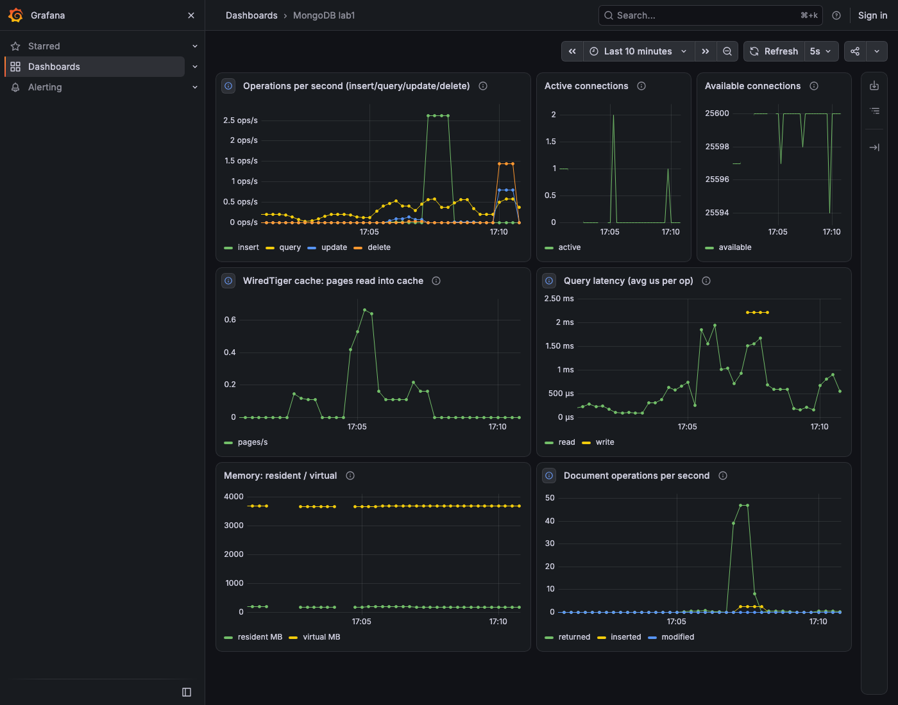
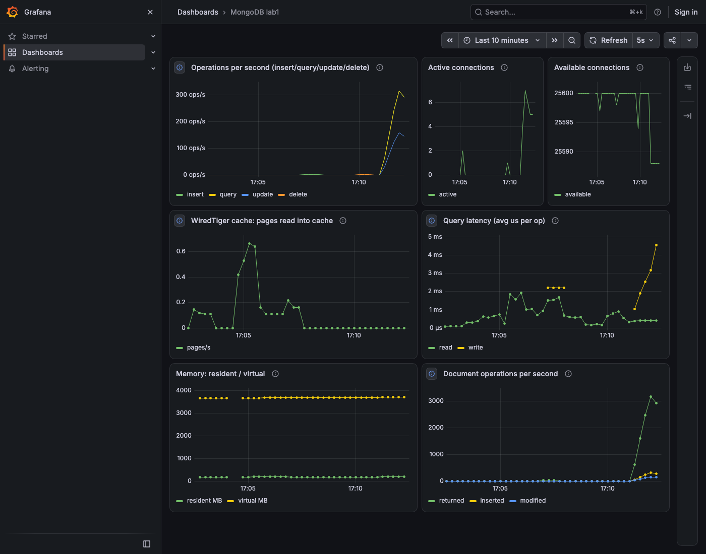
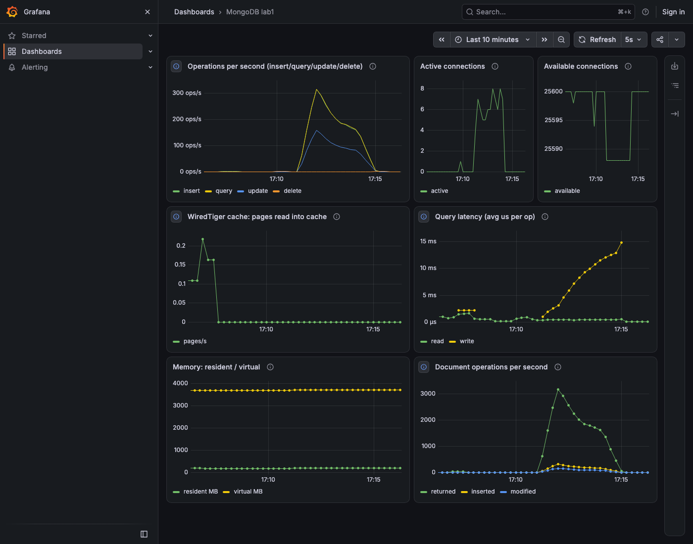

# Лабораторная работа 1. Эксплуатация MongoDB

Цель работы: развернуть MongoDB на виртуальной машине без Docker и освоить основные операции сопровождения - автозапуск, управление сервисом, ролевая модель, резервное копирование и мониторинг. Все управление - Ansible-ролями с Mac по SSH. Конфигурация воспроизводится одним запуском `site.yml`

## Структура проекта

- `site.yml` - основной playbook: разворачивает и настраивает все
- `load.yml` - запуск нагрузки на учебную базу (часть 4)
- `roles/mongodb` - установка MongoDB 8.0 из официального apt-репозитория, настройка, сервисные операции (start/stop/restart, статус, health-check)
- `roles/seed` - создание admin-пользователя и учебных баз `library` и `shop`
- `roles/rbac` - ролевая модель (часть 2): роли и пользователи создаются всегда. Демонстрации назначения и отзыва роли, изменения прав, доступа к коллекции и удаления запускаются отдельными тегами
- `roles/backup` - резервное копирование (часть 3): по тегу `backup` делает копию каждой учебной базы и одну общую, по тегу `restore` показывает восстановление одной удаленной коллекции
- `roles/monitoring` - mongodb_exporter, Prometheus, Grafana (часть 4)
- `roles/load` - нагрузочный генератор на pymongo

Запуск: адрес виртуальной машины передается через переменную окружения `LAB1_MONGO_HOST` (адрес не хранится в репозитории), все секреты - через Ansible Vault в git-ignored файле `vault.yml`. mongodump, mongorestore и генератор нагрузки читают пароль из root-only файлов, поэтому в их командной строке пароля нет

```bash
export LAB1_MONGO_HOST=<адрес ВМ>
export LAB1_VAULT=<путь к vault.yml>
export ANSIBLE_VAULT_PASSWORD_FILE=<путь к файлу с паролем vault>
ansible-galaxy collection install -r requirements.yml
ansible-playbook site.yml
```

Большинство пунктов выполняется тегами: roles, health, start, stop, restart, status, grant, privileges, collection, drop, backup, restore

## Часть 1. Базовая настройка

### 1.1 Подготовка хоста и развертывание

Сначала подключаю официальный apt-репозиторий MongoDB для Ubuntu 24.04: ключ преобразую в бинарный вид командой `gpg --dearmor` и кладу в `/usr/share/keyrings`, источник - в формате deb822 с `Signed-By`. Версия - 8.0. Метапакет `mongodb-org` целиком не ставлю, только нужные компоненты: `mongodb-org-server`, `mongodb-mongosh` и `mongodb-database-tools`

Один запуск `site.yml` разворачивает все с нуля: mongod, admin-пользователя через исключение localhost, учебные базы, роли и пользователей, мониторинг

```bash
ansible-playbook site.yml
```

```text
PLAY RECAP *********************************************************************
mongo                      : ok=58   changed=45   unreachable=0    failed=0    skipped=0    rescued=0    ignored=0   
```

### 1.2 Автозапуск после перезагрузки

`mongod` включен в systemd (`enabled: true`). Автозапуск проверяю настоящей перезагрузкой ВМ: после перезагрузки запускаю только health-check через Ansible, сам mongod вручную не стартую

```bash
ssh root@<mongo-vm> 'reboot'
# после того как ВМ вернулась:
ansible-playbook site.yml --tags health,status
```

```text
    "msg": "mongod is running"
    "msg": "MongoDB: available (ping ok=1)"
```

### 1.3 Запуск, остановка, перезапуск

Сервисные операции выполняются отдельными тегами:

```bash
ansible-playbook site.yml --tags start
ansible-playbook site.yml --tags stop
ansible-playbook site.yml --tags restart
```

Проверяю статус сразу после перезапуска, а остановку - отдельным тегом `stop` с выводом:

```bash
ansible-playbook site.yml --tags restart,status
ansible-playbook site.yml --tags stop
```

```text
    "msg": "mongod is running"
```

```text
changed: [mongo]
mongo                      : ok=5    changed=1    unreachable=0    failed=0    skipped=0    rescued=0    ignored=0   
```

### 1.4 Проверка доступности

Пингую сервер через mongosh и печатаю вердикт в одну строку

```bash
ansible-playbook site.yml --tags health
```

```text
    "msg": "MongoDB: available (ping ok=1)"
```

После остановки проверка должна сообщить, что сервер недоступен. Это отрицательный тест:

```bash
ansible-playbook site.yml --tags stop
ansible-playbook site.yml --tags health
```

(вывод сокращен)

```text
[ERROR]: Task failed: Module failed: The command exited with a non-zero return code.
fatal: [mongo]: FAILED! => stderr: MongoNetworkError: connect ECONNREFUSED 127.0.0.1:27017
```

## Часть 2. Ролевая модель

Роли и пользователей создаю модулями коллекции `community.mongodb` 1.8.1 (`mongodb_role`, `mongodb_user`, `mongodb_shell`), декларативно, из списков в `vars` роли `rbac`. Коллекция подключена через `requirements.yml` (`ansible-galaxy collection install -r requirements.yml`). Модулям нужен pymongo 4+, а в репозитории Ubuntu 24.04 только pymongo 3.11.0, поэтому роль `mongodb` ставит pymongo 4.20.0 в отдельный venv и заданиям с модулями указывает его как интерпретатор

### Пользователи учебных баз и кастомные роли (пункты 2.1, 2.2)

Четыре кастомные роли с разными наборами прав: `libraryReader` (только find), `libraryWriter` (find/insert/update/remove), `booksOnly` (одна коллекция `books`) и `shopReader` на `shop`. Первые три роли получают постоянных пользователей (anna, boris, vera) сразу, а `shopReader` остается без пользователя до демо пункта 2.3. Пароли берутся из vault, `update_password: on_create` не дает повторному запуску считать пользователя измененным, `no_log` прячет пароли из вывода

```bash
ansible-playbook site.yml --tags roles
```

```text
        "[\"role libraryReader on library\",\"role libraryWriter on library\",\"role booksOnly on library\",\"user anna: libraryReader\",\"user boris: libraryWriter\",\"user vera: booksOnly\"]",
        "[\"role shopReader on shop\"]"
```

Печать списка ролей через `mongodb_shell` я сначала написал по памяти: `db.getRoleInfos()`. Такого метода в mongosh нет, и задача упала с `TypeError: getRoleInfos is not a function`. Правильный метод называется `db.getRoles()`

### Назначение и отзыв роли (пункт 2.3)

Демо-пользователю `grigory` выдается роль `shopReader` (модуль `mongodb_user` обновляет его список ролей), затем роль отзывается тем же модулем. После каждой операции я проверяю чтение как он: настоящий `find` по `shop.orders` и список его ролей через `mongodb_shell`

```bash
ansible-playbook site.yml --tags grant
```

```text
    "msg": "after grant: read ok, fetched 1 doc(s)"
    "msg": "roles now: [\"shopReader\"]"
    "msg": "after revoke: refused: MongoServerError: not authorized on shop to execute command { find: \"orders\", filter: {}, limit: 1, lsid: { id: UUID(\"884ebd66-3779-4e7b-b319-44f31417cb18\") }, $db: \"shop\" }"
    "msg": "roles now: []"
```

### Изменение прав существующей роли (пункт 2.4)

Сначала я хотел показать изменение прав на примере поинтереснее: дать `libraryWriter` чтение коллекции `shop.products` из соседней базы. Сервер не дал: `Roles on the library database cannot be granted privileges that target other databases`. Оказалось, что роль в MongoDB живет в своей базе и раздает права только внутри нее, а роль с правами на несколько баз создается в `admin`. Я показал изменение внутри `library`: `libraryWriter` получает `createIndex` и `dropIndex` на коллекцию `books`, потом набор возвращается к прежнему. Печатаю привилегии после добавления и после возврата

```bash
ansible-playbook site.yml --tags privileges
```

```text
    "msg": "after adding: [{\"resource\":{\"db\":\"library\",\"collection\":\"\"},\"actions\":[\"find\",\"insert\",\"remove\",\"update\"]},{\"resource\":{\"db\":\"library\",\"collection\":\"books\"},\"actions\":[\"createIndex\",\"dropIndex\",\"find\",\"insert\",\"remove\",\"update\"]}]"
    "msg": "after revert: [{\"resource\":{\"db\":\"library\",\"collection\":\"\"},\"actions\":[\"find\",\"insert\",\"remove\",\"update\"]}]"
```

### Доступ к одной коллекции без доступа к базе (пункт 2.5)

Пользователь `vera` с ролью `booksOnly` читает `books` - успешно. Чтение `readers` - отказ с ошибкой авторизации сервера

```bash
ansible-playbook site.yml --tags collection
```

```text
    "msg": "allowed collection library.books: read ok, fetched 1 doc(s)"
    "msg": "denied collection library.readers: MongoServerError: not authorized on library to execute command { find: \"readers\", filter: {}, limit: 1, lsid: { id:..."
```

### Удаление роли и пользователя (пункт 2.6)

Удаляю демо-пару `shopReader` и `grigory` через `state: absent` у `mongodb_user` и `mongodb_role`. Повторный запуск того же тега печатает "already absent":

```bash
ansible-playbook site.yml --tags drop
```

```text
        "user grigory: dropped",
        "role shopReader: dropped"
```

```bash
ansible-playbook site.yml --tags drop
```

```text
        "user grigory: already absent",
        "role shopReader: already absent"
```

## Часть 3. Резервное копирование

### Копии без перезаписи (пункты 3.1-3.3)

Копии: `mongodump --gzip --config /root/.mongodb-tools.conf --archive=/var/backups/mongodb/<db>/dump-<дата-время>.archive`. Имя файла собирает Ansible-функция `now()`, поэтому новая копия не перезаписывает предыдущую. Каждой учебной базе соответствует своя копия, плюс общая для всех баз (`all`). Штамп в имени - UTC, как и время `ls` на ВМ с часовым поясом UTC, поэтому имя и листинг сходятся

Пароль для mongodump лежит в root-only файле `/root/.mongodb-tools.conf` (0600) и передается через `--config`: в `ps` и в выводе команда видна без пароля

```bash
ansible-playbook site.yml --tags backup
```

Архивы на самой ВМ:

```bash
ssh root@<mongo-vm> 'ls -lh /var/backups/mongodb/*/'
```

```text
/var/backups/mongodb/all/:
total 16K
-rw-r--r-- 1 root root 14K Nov 15 14:06 dump-20261115-140645.archive

/var/backups/mongodb/library/:
total 16K
-rw-r--r-- 1 root root 5.3K Nov 15 14:06 dump-20261115-140641.archive
-rw-r--r-- 1 root root 5.3K Nov 15 14:07 dump-20261115-140659.archive

/var/backups/mongodb/shop/:
total 8.0K
-rw-r--r-- 1 root root 7.5K Nov 15 14:06 dump-20261115-140642.archive
```

### Восстановление после удаления коллекции (пункт 3.4)

Демонстрацию проводит отдельный тег `restore`:

- число документов до удаления (`before drop`)
- удаление `library.readers` через `mongodb_shell`
- пусто после (`after drop`)
- свежая копия базы прямо в демо
- восстановление только этой коллекции (`mongorestore --nsInclude=library.readers`)
- число документов совпадает с исходным (`after restore`)
- соседняя коллекция `books` не затронута (`untouched`)

```bash
ansible-playbook site.yml --tags restore
```

```text
    "msg": "before drop: library.readers has 150 documents"
    "msg": "after drop: \"0 (readers is gone)\""
    "msg": "after restore: library.readers has 150 documents"
    "msg": "untouched library.books still has 300 documents"
```

Здесь я тоже ошибся по привычке к модулю `command`: прочитал результат `mongodb_shell` из `stdout` и получил `object of type dict has no attribute stdout`. У модуля другая схема возврата: результат выражения лежит в `transformed_output`, а `msg` занят служебной строкой про тип трансформации

## Часть 4. Мониторинг

### Экспортер (пункт 4.1)

Percona `mongodb_exporter` 0.54, бинарником из GitHub Releases под systemd. Включен сбор диагностических метрик (`--collector.diagnosticdata`), без него часть метрик недоступна. Подключение к mongod локальное. Экспортер работает под собственным пользователем `exporter` со встроенной ролью `clusterMonitor`, а не под admin

Экспортер запущен и слушает только localhost, порт 9216

```bash
ssh root@<mongo-vm> 'systemctl is-active mongodb_exporter; ss -tlnp | grep 9216 | head -1'
```

```text
active
LISTEN 0      4096       127.0.0.1:9216       0.0.0.0:*    users:(("mongodb_exporte",pid=524,fd=3))             
```

### Выбор метрик (пункт 4.2)

- **Operations per second** (insert/query/update/delete) - показывает, какие операции генерирует нагрузка
- **Connections (active/available)** - рост активных подключений говорит о повышенной нагрузке
- **WiredTiger cache: pages read into cache** - если растет, рабочая выборка не помещается в кэш
- **Query latency (avg us per op)** - средняя задержка операций: главный признак, что БД не успевает. Экспортер не отдает ее готовой, поэтому панель делит скорость роста суммарного времени `opLatencies_latency` на скорость роста числа `opLatencies_ops` за минуту - микросекунды на операцию
- **Memory: resident/virtual** - потребление RAM процессом mongod
- **Document operations per second** (returned/inserted/updated) - детали влияния нагрузки на документы

В exporter 0.54 тип операции лежит в метке: `mongodb_ss_opcounters{legacy_op_type="insert"}` для операций и `mongodb_ss_metrics_document{doc_op_type="inserted"}` для документов

### Дашборд (пункт 4.3)

Grafana 13.3 ставится .deb-пакетом из GitHub Releases. Источник Prometheus и дашборд роль создает через provisioning, JSON дашборда лежит в `roles/monitoring/files/mongodb-dashboard.json`. Снаружи открыт только порт 22, поэтому веб-интерфейсы доступны через SSH-туннель

Анонимный вход включает systemd drop-in с переменными `GF_AUTH_ANONYMOUS_*`. Файл в `grafana.ini.d` не подходит: пакет Grafana читает только `/etc/grafana/grafana.ini`



### Нагрузка и ее влияние на графики (пункт 4.4)

Генератор нагрузки (`roles/load/files/load_gen.py`, pymongo 4.20.0 из venv роли `mongodb`) 3 минуты гоняет вставки, чтения и обновления в `shop.load_docs` в 4 потока:

```bash
ansible-playbook load.yml
```

```text
    "msg": "load done: {'insert': 41445, 'find': 41487, 'update': 20929}"
```

Числа я снял из Prometheus трижды: прямо перед запуском, в середине прогона и через две минуты после конца, когда минутное окно `rate` уже целиком приходится на тишину. Штампы в выводе - время Mac (МСК), штампы панелей Grafana - UTC на ВМ. Каждое число - мгновенный запрос к `/api/v1/query` через SSH-туннель на порт 9090:

| Строка вывода | PromQL |
|---|---|
| `ops_insert_rate_per_sec` | `sum(rate(mongodb_ss_opcounters{legacy_op_type="insert"}[1m]))`, для query, update и delete так же |
| `connections_active`, `connections_available` | `mongodb_ss_connections{conn_type="active"}`, `{conn_type="available"}` |
| `mem_resident_mb` | `mongodb_ss_mem_resident` |
| `wt_cache_pages_read_rate` | `sum(rate(mongodb_ss_wt_cache_pages_read_into_cache[1m]))` |

```text
--- before (17:10:54, instant query, rate window [1m]) ---
ops_insert_rate_per_sec: 0
ops_query_rate_per_sec: 0.2727272727272727
ops_update_rate_per_sec: 0
ops_delete_rate_per_sec: 0
connections_active: 0
connections_available: 25600
mem_resident_mb: 187
wt_cache_pages_read_rate: 0
--- during (17:12:35, instant query, rate window [1m]) ---
ops_insert_rate_per_sec: 238.56363636363636
ops_query_rate_per_sec: 241.6
ops_update_rate_per_sec: 119.45454545454545
ops_delete_rate_per_sec: 0
connections_active: 6
connections_available: 25588
mem_resident_mb: 199
wt_cache_pages_read_rate: 0
--- after (17:16:25, instant query, rate window [1m]) ---
ops_insert_rate_per_sec: 0
ops_query_rate_per_sec: 0.19999999999999998
ops_update_rate_per_sec: 0
ops_delete_rate_per_sec: 0
connections_active: 0
connections_available: 25600
mem_resident_mb: 206
wt_cache_pages_read_rate: 0
```

Под нагрузкой вставки и чтения выросли почти с нуля до 239-242 операций в секунду, обновления до 119, активных подключений стало 6 вместо 0. Через две минуты после конца все операции вернулись к фону, а резидентная память mongod выросла с 187 до 206 МБ и осталась на этом уровне. Чтение страниц с диска в кэш WiredTiger во время нагрузки - 0: рабочий набор целиком помещается в кэш

Дашборд во время нагрузки и после нее:





## Идемпотентность

Второй подряд прогон `site.yml` ничего не меняет - `changed=0` в PLAY RECAP:

```bash
ansible-playbook site.yml
```

```text
PLAY RECAP *********************************************************************
mongo                      : ok=50   changed=0    unreachable=0    failed=0    skipped=4    rescued=0    ignored=0   
```

Демо ролевой модели, резервного копирования и восстановления, а также нагрузка вынесены за отдельные теги и в обычный прогон не входят

## Что было сложно, а что интересно

Больше всего времени ушло не на сам MongoDB, а на окружение вокруг него: цикл ожидания dpkg-lock на Ubuntu 24.04 зависал, потому что процесс unattended-upgrade-shutdown живет там постоянно, а mongodump 8.0 не понял `--archive` с пробелом перед путем. Интереснее всего было разобраться с localhost exception: на сервере без пользователей MongoDB разрешает ровно одну операцию, и моя же защитная проверка перед созданием первого пользователя ее нарушала. В итоге проверку убрал, первого пользователя создаю сразу модулем `mongodb_user`, а от повтора защищает файл-маркер
