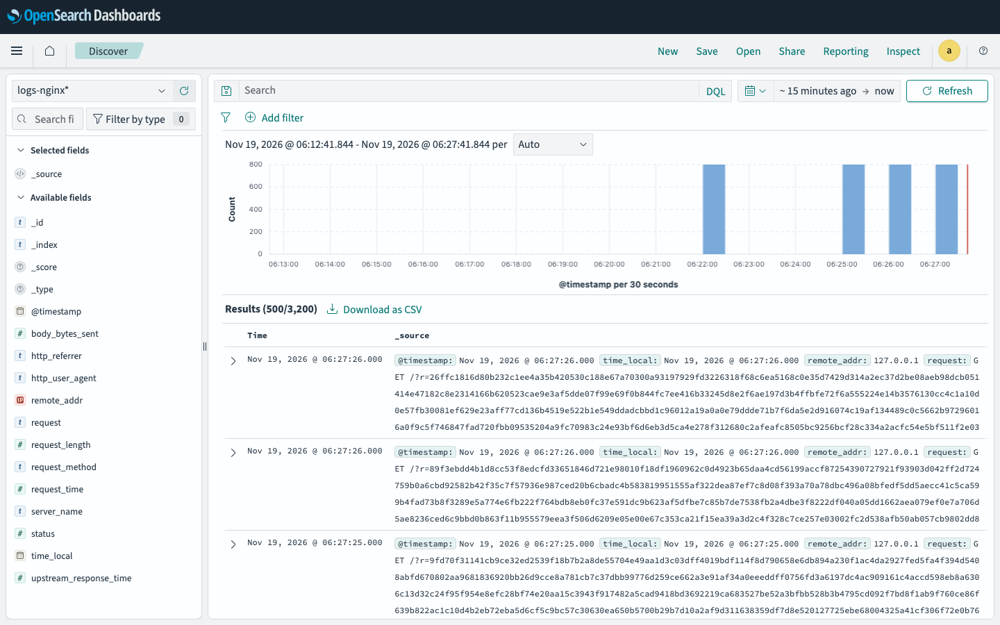
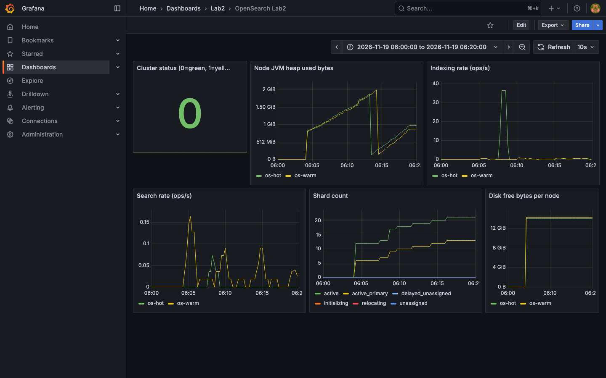

# Лабораторная работа 2. Эксплуатация OpenSearch: hot-warm кластер с TLS и управлением жизненным циклом логов

## Задача

Развернуть защищенный кластер OpenSearch 3.8 в hot-warm архитектуре на трех виртуальных машинах: TLS на транспортном и REST уровнях, OpenSearch Dashboards, ролевая модель (запись/чтение/мониторинг), конвейер nginx -> Fluent Bit -> data stream `logs-nginx`, политика ISM (rollover 1 МБ или 1 минута, перенос на warm-узел, удаление через 10 минут) и мониторинг через Prometheus-плагин и Grafana

Я развернул все через Ansible со своего Mac: 8 плейбуков (10-prepare ... 80-monitoring), по роли на каждую зону ответственности (`common_pre`, `os_install`, `os_security`, `dashboards_install`, `nginx_fluentbit`, `os_ism`, `os_monitoring`). Адреса узлов приходят из переменных окружения

Наружу открыт только `os-hot`, остальные узлы доступны через него по ProxyJump, поэтому IP в репозитории нет. В командах ниже узлы адресуются по имени из `~/.ssh/config`. Пароли лежат в vault-файле `group_vars/lab2/vault.yml`, он в `.gitignore` (образец - `vault.example.yml`). В командах пароли заменены на `<пароль>`. Перед запуском нужны `uv` (через него роль `os_security` считает bcrypt-хэши) и коллекции из `requirements.yml`:

```bash
export LAB2_HOT_HOST=<адрес hot-vm>
export LAB2_WARM_HOST=<адрес warm-vm>
export LAB2_DASH_HOST=<адрес dash-vm>
export LAB2_JUMP_HOST=<публичный адрес hot-vm>
export ANSIBLE_VAULT_PASSWORD_FILE=<путь к файлу с паролем vault>
ansible-galaxy collection install -r requirements.yml
ansible-playbook site.yml
```

## Часть 1. Развертывание

### Кластер

Три узла:

- `os-hot` - data-узел с `node.attr.temp: hot`, на нем же nginx и Fluent Bit
- `os-warm` - data-узел с `node.attr.temp: warm`
- `os-dash` - cluster-manager-only узел (шарды не хранит, heap 1 ГБ вместо половины памяти), на нем же Dashboards, Prometheus и Grafana

Я поставил OpenSearch 3.8 из официального tarball в `/opt/opensearch`, он работает под systemd-юнитом, а весь кластер собирается одним прогоном `site.yml`. Первое развертывание на чистых ВМ, со своего Mac:

```bash
ansible-playbook site.yml
```

```text
...
PLAY RECAP *********************************************************************
os-dash                    : ok=65   changed=49   unreachable=0    failed=0    skipped=0    rescued=0    ignored=0   
os-hot                     : ok=54   changed=37   unreachable=0    failed=0    skipped=2    rescued=0    ignored=0   
os-warm                    : ok=29   changed=19   unreachable=0    failed=0    skipped=1    rescued=0    ignored=0   
```

Хелсчек кластера после сборки, на dash-узле:

```bash
curl -sk -u admin:<пароль> "https://127.0.0.1:9200/_cluster/health?pretty"
```

```text
{
  "cluster_name" : "lab2-os",
  "status" : "green",
  "timed_out" : false,
  "number_of_nodes" : 3,
  "number_of_data_nodes" : 2,
  "discovered_master" : true,
  "discovered_cluster_manager" : true,
  "active_primary_shards" : 6,
  "active_shards" : 12,
  "relocating_shards" : 0,
  "initializing_shards" : 0,
  "unassigned_shards" : 0,
  "delayed_unassigned_shards" : 0,
  "number_of_pending_tasks" : 0,
  "number_of_in_flight_fetch" : 0,
  "task_max_waiting_in_queue_millis" : 0,
  "active_shards_percent_as_number" : 100.0
}
```

Версию 3.8 подтверждают Dashboards (3.8.0 в ответе `api/status` ниже) и плагин prometheus-exporter 3.8, который ставится только на OpenSearch той же версии

При первой сборке кластер не собрался из-за двух ошибок в конфигурации. Первая: узлы стартовали, но REST-порт не открылся ни на одном, а в логе без конца повторялось "Cluster manager not present". Я оставил `network.host: 127.0.0.1`, поэтому транспорт слушал только loopback и узлы не видели друг друга. С `network.host: [_local_, _site_]` транспорт стал слушать еще и адрес в частной сети

Вторая: первый вариант systemd-юнита был с `Type=forking`. Скрипт запуска из tarball не делает fork и остается в foreground, поэтому systemd не дожидался запуска и на 180-й секунде убивал службу по таймауту. С `Type=simple` служба стартует нормально

Какую роль выполняет каждый узел и насколько заполнен его heap (`_cat/nodes` на dash-узле, `m` - cluster manager, `d` - data):

```bash
curl -sk -u admin:<пароль> "https://127.0.0.1:9200/_cat/nodes?v&h=name,heap.percent,role"
```

```text
name    heap.percent role
os-warm           28 d
os-hot            28 d
os-dash           20 m
```

Все три узла успешно вошли в кластер. Чтобы убедиться, что узлы помечены правильно, я вывел их атрибуты через `_cat/nodeattrs` на dash-узле:

```bash
curl -sk -u admin:<пароль> "https://127.0.0.1:9200/_cat/nodeattrs?v&h=node,attr,value" | grep -E "node|temp"
```

```text
node    attr                            value
os-warm temp                            warm
os-hot  temp                            hot
```

### TLS

Я генерирую свой CA, node- и admin-сертификаты ролью `os_security` на базе модулей `community.crypto` (`openssl_privatekey`, `openssl_csr`, `x509_certificate`) и раскладываю их по узлам. Коллекция закреплена в `requirements.yml`. Сертификат каждого узла я выписал на его IP и на 127.0.0.1 (поле SAN). Поэтому Fluent Bit, Prometheus и Dashboards подключаются к кластеру с полной проверкой TLS по `root-ca.pem`, отключать ее не пришлось

REST-порт принимает только HTTPS. На обычный HTTP-запрос к 9200 узел ждет TLS-handshake, ничего не отвечает и закрывает соединение, curl выходит с кодом 52 (Empty reply from server). Запрос по HTTPS с моим корневым сертификатом в `--cacert` проходит, а без него curl не доверяет самоподписанному CA и выходит с кодом 60. Все проверки я запускал на dash-узле:

```bash
curl -s -o /dev/null --max-time 5 http://127.0.0.1:9200/ || echo "http 127.0.0.1:9200 -> empty reply from server (curl exit $?)"
curl -s --cacert /opt/lab2-pki/root-ca.pem -u admin:<пароль> -o /dev/null -w "https verified by own CA -> %{http_code}\n" https://127.0.0.1:9200/
curl -s -u admin:<пароль> -o /dev/null https://127.0.0.1:9200/ || echo "https without CA -> SSL certificate problem: self-signed CA in chain (curl exit $?)"
openssl x509 -in /opt/opensearch/config/certs/node.pem -noout -subject -dates -issuer
```

```text
http 127.0.0.1:9200 -> empty reply from server (curl exit 52)
https verified by own CA -> 200
https without CA -> SSL certificate problem: self-signed CA in chain (curl exit 60)
subject=CN = os-dash, O = lab2
notBefore=Nov 19 05:52:58 2026 GMT
notAfter=Nov 18 05:52:58 2028 GMT
issuer=CN = lab2-root-ca, O = lab2
```

Узлы общаются между собой по mutual TLS: каждый узел пускает к себе только тех, чей DN сертификата есть в `nodes_dn`. На первом прогоне сертификаты делал openssl-скрипт с `-subj /CN=x/O=lab2`, и узлы не смогли соединиться:

```text
Node presenting certificate with SSL Principal {O=lab2,CN=os-warm} could not securely connect to the cluster
```

В `nodes_dn` я записал `CN=os-warm,O=lab2`, а плагин безопасности сравнивает DN в формате RFC 2253. Этот формат выводит части имени в обратном порядке, поэтому у сертификата получилось `O=lab2,CN=os-warm`, и строки не совпали. Я поправил порядок в `nodes_dn`, а генерацию сертификатов перевел на `community.crypto`

С `community.crypto` ошибка повторилась наоборот. Я указал `subject_ordered: [O, CN]`, в том же порядке, что и в `nodes_dn`, но в RFC 2253 порядок снова развернулся, и получилось `CN=os-warm,O=lab2`. Правильно так: в `subject_ordered` сначала CN, потом O. Тогда в RFC 2253 выходит `O=lab2,CN=<имя>`, ровно как в `nodes_dn`. После каждой перегенерации я проверял DN командой `openssl x509 -nameopt RFC2253 -noout -subject`. С этим порядком узлы наконец соединились

На транспортном порту 9300 узел отдает свой сертификат и требует клиентский. Проверка на hot-узле. Без клиентского сертификата цепочка сервера проверяется, но узел обрывает соединение:

```bash
sleep 2 | openssl s_client -connect 127.0.0.1:9300 -CAfile /opt/opensearch/config/certs/root-ca.pem 2>&1 | grep -E 'Verify return code|alert'
```

```text
Verify return code: 0 (ok)
80EBB117C17F0000:error:0A00045C:SSL routines:ssl3_read_bytes:tlsv13 alert certificate required:../ssl/record/rec_layer_s3.c:1593:SSL alert number 116
```

С сертификатом узла соединение проходит без ошибок:

```bash
sleep 2 | openssl s_client -connect 127.0.0.1:9300 -CAfile /opt/opensearch/config/certs/root-ca.pem -cert /opt/opensearch/config/certs/node.pem -key /opt/opensearch/config/certs/node-key.pem 2>&1 | grep -E 'Verify return code|alert'
```

```text
Verify return code: 0 (ok)
    Verify return code: 0 (ok)
```

### Dashboards

Dashboards (пункт 1.1b) ставит роль `dashboards_install` на os-dash. Сервис слушает порт 5601 только на loopback и подключается к кластеру по HTTPS через cluster-manager-узел. Статус на dash-узле:

```bash
curl -s -u admin:<пароль> "http://127.0.0.1:5601/api/status" | python3 -m json.tool
```

```text
{
...
    "version": {
        "number": "3.8.0",
...
    "status": {
        "overall": {
...
            "state": "green",
...
```

Discover на `logs-nginx` после входа. Перед скриншотом я несколько раз запускал генератор по 800 запросов: на гистограмме видны эти всплески, в таблице их документы



## Часть 2. Ролевая модель

Три своих роли в `roles/os_security/files/securityconfig/roles.yml` и три пользователя в `internal_users.yml`. Пароли там хранятся bcrypt-хэшами, сам файл собирается из шаблона:

- `log_writer` - запись только в data stream `logs-nginx`
- `log_reader` - чтение только индексов `logs*`
- `log_monitor` - минимальные права на метрики кластера и узлов

Проверка прав на dash-узле. Справа в комментарии стоит ожидаемый код, в выводе ниже полученные коды в том же порядке:

```bash
printf '%s\n%s\n' '{"create":{"_index":"logs-nginx"}}' '{"@timestamp":"2026-11-08T12:00:00Z","remote_addr":"127.0.0.1","request":"GET / HTTP/1.1","status":200,"body_bytes_sent":608}' > /tmp/bulk2.ndjson
curl -sk -u log_writer:<пароль> -XPUT -H 'Content-Type: application/x-ndjson' --data-binary @/tmp/bulk2.ndjson -o /dev/null -w '%{http_code}\n' https://127.0.0.1:9200/_bulk  # 200
curl -sk -u log_writer:<пароль> -XPOST -H 'Content-Type: application/json' -d '{"a":1}' -o /dev/null -w '%{http_code}\n' https://127.0.0.1:9200/other-index/_doc  # 403
curl -sk -u log_writer:<пароль> -o /dev/null -w '%{http_code}\n' https://127.0.0.1:9200/logs-nginx/_search  # 403
curl -sk -u log_writer:<пароль> -XDELETE -o /dev/null -w '%{http_code}\n' https://127.0.0.1:9200/_data_stream/logs-nginx  # 403
curl -sk -u log_reader:<пароль> -o /dev/null -w '%{http_code}\n' https://127.0.0.1:9200/logs-nginx/_search  # 200
curl -sk -u log_reader:<пароль> -XPUT -H 'Content-Type: application/x-ndjson' --data-binary @/tmp/bulk2.ndjson -o /dev/null -w '%{http_code}\n' https://127.0.0.1:9200/_bulk  # 403
curl -sk -u log_reader:<пароль> -XDELETE -o /dev/null -w '%{http_code}\n' https://127.0.0.1:9200/_data_stream/logs-nginx  # 403
curl -sk -u log_monitor:<пароль> -o /dev/null -w '%{http_code}\n' https://127.0.0.1:9200/_cluster/health  # 200
curl -sk -u log_monitor:<пароль> -o /dev/null -w '%{http_code}\n' https://127.0.0.1:9200/logs-nginx/_search  # 403
curl -sk -u log_writer:wrong -o /dev/null -w '%{http_code}\n' https://127.0.0.1:9200/  # 401
```

```text
200
403
403
403
200
403
403
200
403
401
```

Каждая роль получает 200 на своем действии и 403 на чужом. Писателю запрещено даже удалить стрим, в который он пишет. Неверный пароль дает 401

## Часть 3. Управление индексами

### nginx и Fluent Bit

Я развернул nginx на `os-hot`: он отдает статическую страницу и пишет access-лог в JSON (`log_format ... escape=json`), фиксируя `remote_addr`, `request`, `status`, `body_bytes_sent` и другие поля. Fluent Bit я поставил из официального apt-репозитория: он читает access-лог (tail) парсером `nginx_json` и шлет документы в data stream `logs-nginx` как `log_writer` по TLS (`Write_Operation create`)

Дальше я проверил, что строка лога доходит до индекса: взял последнюю строку access-лога на hot-узле и нашел в `logs-nginx` документ с тем же параметром `r`. Такой документ один, и `request` с `time_local` у него те же. Последняя строка лога, на hot-узле:

```bash
tail -1 /var/log/nginx/lab2.access.log
```

```text
{"time_local":"19/Nov/2026:06:07:48 +0000","remote_addr":"127.0.0.1","request":"GET /?r=af9f82797ec86964fb743c70a9f8aee63ee92bf5e6a7e9acf21a1f4477f7c9bd812522c944745f8a6307af3050537ff9ffba1f02c693191a1b13a7ca80103c1a83bfd4bc8bbc2b3b3a71b680d2302e90701f7d8e4d9dd096fba244a26959f3cde7ca5e3f7ebb29efb149dadcaa6c2c18c6cc4d3220210e53aad6d23c6ff3e88c93437eea8c2814f829a4713d0a16b61daf5f0475ce2867945af5fdd014bff38b8f881b358e0453207887ab32f46b63ccceb28e9288ca2eccfba4531f9523cc9293cdad59110021de47c611dc3814ee46167b50a58cab573446ee1c96bea545697fc7aa01e1a38570be9457fa98cba6b695e66a88dbfeffb0bfbff2ee8da6f7a6016f5d9d5b7cba8b4f26ce86ae7b7124a5c62cec5c5d748d75fdd47c88e4b88ea40ca52053deb8cdaa510f79f32d0239862f9843dcd9b8eee762a556ea883733d2bf9cf64c3bf204895abf5d3313d98d2628485d9f014424c44d31bb4a0108465962c9038c0a8c5da7cb66c2f084b56f66ad78168eacdbddb2abc59d35fef1db4cb35e17b5c3b55f089e1bb6444943af1046274f160ab6c4456faaa8dd5ee4f876027654292085c4a1eaeefa344c60685fb549ac5a332bfef38752ce4f5136807ae7ace2f1a82b44fcf1dfa3f8fb967ba6273d05e8464c1a206a2f04b84ca793b66f6dc4505a368a58b6cc9de891f70ad6569a2f87ea307604caa96d7f0ff777 HTTP/1.1","request_method":"GET","status":200,"body_bytes_sent":608,"request_length":1100,"request_time":0.000,"upstream_response_time":"","http_referrer":"","http_user_agent":"curl/7.81.0","server_name":"127.0.0.1"}
```

Поиск документа по `r` из этой строки, на dash-узле:

```bash
curl -sk -u admin:<пароль> -XPOST "https://127.0.0.1:9200/logs-nginx/_refresh" -o /dev/null
curl -sk -u admin:<пароль> "https://127.0.0.1:9200/logs-nginx/_search?pretty" -H "Content-Type: application/json" -d '{"size":1,"query":{"match_phrase":{"request":"af9f82797ec86964fb743c70a9f8aee63ee92bf5e6a7e9acf21a1f4477f7c9bd812522c944745f8a6307af3050537ff9ffba1f02c693191a1b13a7ca80103c1a83bfd4bc8bbc2b3b3a71b680d2302e90701f7d8e4d9dd096fba244a26959f3cde7ca5e3f7ebb29efb149dadcaa6c2c18c6cc4d3220210e53aad6d23c6ff3e88c93437eea8c2814f829a4713d0a16b61daf5f0475ce2867945af5fdd014bff38b8f881b358e0453207887ab32f46b63ccceb28e9288ca2eccfba4531f9523cc9293cdad59110021de47c611dc3814ee46167b50a58cab573446ee1c96bea545697fc7aa01e1a38570be9457fa98cba6b695e66a88dbfeffb0bfbff2ee8da6f7a6016f5d9d5b7cba8b4f26ce86ae7b7124a5c62cec5c5d748d75fdd47c88e4b88ea40ca52053deb8cdaa510f79f32d0239862f9843dcd9b8eee762a556ea883733d2bf9cf64c3bf204895abf5d3313d98d2628485d9f014424c44d31bb4a0108465962c9038c0a8c5da7cb66c2f084b56f66ad78168eacdbddb2abc59d35fef1db4cb35e17b5c3b55f089e1bb6444943af1046274f160ab6c4456faaa8dd5ee4f876027654292085c4a1eaeefa344c60685fb549ac5a332bfef38752ce4f5136807ae7ace2f1a82b44fcf1dfa3f8fb967ba6273d05e8464c1a206a2f04b84ca793b66f6dc4505a368a58b6cc9de891f70ad6569a2f87ea307604caa96d7f0ff777"}}}'
```

```text
{
...
  "hits" : {
    "total" : {
      "value" : 1,
...
        "_index" : ".ds-logs-nginx-000001",
...
        "_source":{"@timestamp":"2026-11-19T06:07:48.000Z","time_local":"19/Nov/2026:06:07:48 +0000","remote_addr":"127.0.0.1","request":"GET /?r=af9f82797ec86964fb743c70a9f8aee63ee92bf5e6a7e9acf21a1f4477f7c9bd812522c944745f8a6307af3050537ff9ffba1f02c693191a1b13a7ca80103c1a83bfd4bc8bbc2b3b3a71b680d2302e90701f7d8e4d9dd096fba244a26959f3cde7ca5e3f7ebb29efb149dadcaa6c2c18c6cc4d3220210e53aad6d23c6ff3e88c93437eea8c2814f829a4713d0a16b61daf5f0475ce2867945af5fdd014bff38b8f881b358e0453207887ab32f46b63ccceb28e9288ca2eccfba4531f9523cc9293cdad59110021de47c611dc3814ee46167b50a58cab573446ee1c96bea545697fc7aa01e1a38570be9457fa98cba6b695e66a88dbfeffb0bfbff2ee8da6f7a6016f5d9d5b7cba8b4f26ce86ae7b7124a5c62cec5c5d748d75fdd47c88e4b88ea40ca52053deb8cdaa510f79f32d0239862f9843dcd9b8eee762a556ea883733d2bf9cf64c3bf204895abf5d3313d98d2628485d9f014424c44d31bb4a0108465962c9038c0a8c5da7cb66c2f084b56f66ad78168eacdbddb2abc59d35fef1db4cb35e17b5c3b55f089e1bb6444943af1046274f160ab6c4456faaa8dd5ee4f876027654292085c4a1eaeefa344c60685fb549ac5a332bfef38752ce4f5136807ae7ace2f1a82b44fcf1dfa3f8fb967ba6273d05e8464c1a206a2f04b84ca793b66f6dc4505a368a58b6cc9de891f70ad6569a2f87ea307604caa96d7f0ff777 HTTP/1.1","request_method":"GET","status":200,"body_bytes_sent":608,"request_length":1100,"request_time":0.0,"upstream_response_time":"","http_referrer":"","http_user_agent":"curl/7.81.0","server_name":"127.0.0.1"}
...
```

С конвейером вышла неприятная история. Прогон генератора на 2 МБ добавлял в access-лог почти 7 тысяч строк, а `_count` в `logs-nginx` вырастал на пару десятков документов: конвейер терял почти всю нагрузку

Причина была в двух настройках, которые я включил сам: `Generate_ID On` и `Write_Operation create`. `Generate_ID` строит `_id` из содержимого записи, и одинаковые записи получают одинаковый `_id`. Мой генератор тогда слал один и тот же `GET /`, а nginx пишет время с точностью до секунды, так что за секунду в логе появлялось до 75 одинаковых строк. Во всем накопленном логе таких групп дублей было 1736, лишних строк 49 967. Каждый дубль получал `_id` первой записи своей секунды, а `create` с существующим `_id` OpenSearch отклоняет: `_bulk` отвечал HTTP 200, но с `"errors": true` и `409 version_conflict_engine_exception` на каждый дубль

Я убрал `Generate_ID`. Без него Fluent Bit не передает `_id`, OpenSearch генерирует его сам, и каждый `create` проходит

После исправления я сравнил число строк лога с числом документов до нагрузки и после. Лишний документ в стриме - тестовая запись `log_writer` из проверки прав выше, ее сделал не конвейер

До прогона, строки и байты access-лога на hot-узле:

```bash
wc -lc < /var/log/nginx/lab2.access.log
```

```text
0 0
```

Документы в `logs-nginx`, на dash-узле:

```bash
curl -sk -u admin:<пароль> "https://127.0.0.1:9200/logs-nginx/_count?pretty"
```

```text
{
  "count" : 1,
...
```

Нагрузку дает генератор `load.sh` на hot-узле: 2000 запросов к nginx по 8 параллельно, у каждого своя случайная строка `r` длиной около 1 КБ. Прогон шел с 06:07:33 до 06:07:48 UTC. Скрипт ничего не печатает, прирост видно по счетчикам ниже:

```bash
/usr/local/bin/lab2-load.sh 2000
```

После прогона, строки и байты лога на hot-узле:

```bash
wc -lc < /var/log/nginx/lab2.access.log
```

```text
   2000 2660000
```

И документы на dash-узле:

```bash
curl -sk -u admin:<пароль> "https://127.0.0.1:9200/logs-nginx/_count?pretty"
```

```text
{
  "count" : 2001,
...
```

После этого порог 1 МБ по `store.size` долго не достигался по другой причине. Одинаковые 300-байтные JSON-строки Lucene сжимает примерно в 9 раз, и 2 МБ лога превращались на диске в ~230 КБ. Поэтому у каждого запроса генератора своя случайная строка: такие документы почти не сжимаются, и порог достигается меньше чем за минуту нагрузки

### Шаблон индекса и ISM

Index template `logs-nginx` лежит в `roles/os_ism/files/index_template.json`: `data_stream: {}`, маппинги полей nginx-лога, 1 шард без реплик. То, что шаблон загружен и стрим его использует, видно через API. Стрим, на dash-узле:

```bash
curl -sk -u admin:<пароль> "https://127.0.0.1:9200/_data_stream/logs-nginx?pretty"
```

```text
{
  "data_streams" : [
...
          "index_name" : ".ds-logs-nginx-000001",
...
      "status" : "GREEN",
      "template" : "logs-nginx"
...
```

Сам шаблон:

```bash
curl -sk -u admin:<пароль> "https://127.0.0.1:9200/_index_template/logs-nginx?pretty"
```

```text
{
  "index_templates" : [
...
      "index_template" : {
        "index_patterns" : [
          "logs-nginx*"
...
        "composed_of" : [ ],
        "data_stream" : {
...
```

Реплик нет не ради экономии. Warm-узел в кластере один, и когда ISM переносит индекс стрима (backing index) на warm (`require temp: warm`), основной шард уже лежит там. Реплику поставить некуда, а держать ее на hot бессмысленно. С репликой индекс остался бы желтым

Политика `logs-nginx-policy` в отдельном `ism_policy.json` (в `files/` роли, а не внутри задачи Ansible):

- rollover: `min_size: 1mb` **или** `min_index_age: 1m` - что раньше
- после rollover - перенос на warm (`allocation` по `temp: warm`)
- `delete` через 10 минут жизни индекса

Интервал проверки ISM я снизил до 1 минуты, иначе каждый переход ждал бы по умолчанию 5 минут. Это настройка кластера, проверка на dash-узле:

```bash
curl -sk -u admin:<пароль> "https://127.0.0.1:9200/_cluster/settings?flat_settings=true" | grep job_interval
```

```text
{"persistent":{"plugins.index_state_management.job_interval":"1"},"transient":{}}
```

На повторном прогоне сломалось обновление политики: PUT падал с `409 version_conflict_engine_exception`, потому что политика уже существовала. OpenSearch обновляет политику только с актуальными `_seq_no` и `_primary_term`. Теперь роль сначала читает их GET-запросом и передает в PUT как `?if_seq_no=&if_primary_term=`

Нагрузку я давал при уже работающем мониторинге, цели Prometheus описаны ниже в разделе «Prometheus-плагин». Все времена в UTC

До нагрузки, в 06:07:30, я снял heap used, heap max и indexing rate тремя instant-запросами к Prometheus на dash-узле. Heap used по узлам (байты):

```bash
curl -s "http://127.0.0.1:9090/api/v1/query" --data-urlencode "query=sum by (node) (opensearch_jvm_mem_heap_used_bytes)"
```

```text
{"status":"success","data":{"resultType":"vector","result":[{"metric":{"node":"os-hot"},"value":[1795068451.072,"1203220704"]},{"metric":{"node":"os-warm"},"value":[1795068451.072,"1226833920"]}]}}
```

Heap max (байты):

```bash
curl -s "http://127.0.0.1:9090/api/v1/query" --data-urlencode "query=sum by (node) (opensearch_jvm_mem_heap_max_bytes)"
```

```text
{"status":"success","data":{"resultType":"vector","result":[{"metric":{"node":"os-hot"},"value":[1795068451.815,"4160749568"]},{"metric":{"node":"os-warm"},"value":[1795068451.815,"4160749568"]}]}}
```

Indexing rate (ops/s, окно 1 минута):

```bash
curl -s "http://127.0.0.1:9090/api/v1/query" --data-urlencode "query=sum by (node) (rate(opensearch_indices_indexing_index_count[1m]))"
```

```text
{"status":"success","data":{"resultType":"vector","result":[{"metric":{"node":"os-hot"},"value":[1795068452.441,"0.03636363636363636"]},{"metric":{"node":"os-warm"},"value":[1795068452.441,"0.01818181818181818"]}]}}
```

Сразу после конца нагрузки, в 06:07:48, те же три запроса (ответы в том же порядке: heap used, heap max, indexing rate):

```text
{"status":"success","data":{"resultType":"vector","result":[{"metric":{"node":"os-hot"},"value":[1795068468.899,"1287106784"]},{"metric":{"node":"os-warm"},"value":[1795068468.899,"1258291200"]}]}}
{"status":"success","data":{"resultType":"vector","result":[{"metric":{"node":"os-hot"},"value":[1795068469.582,"4160749568"]},{"metric":{"node":"os-warm"},"value":[1795068469.582,"4160749568"]}]}}
{"status":"success","data":{"resultType":"vector","result":[{"metric":{"node":"os-hot"},"value":[1795068470.244,"36.4"]},{"metric":{"node":"os-warm"},"value":[1795068470.244,"0.01818115704883459"]}]}}
```

Через полторы минуты после нагрузки, в 06:09:18, те же три запроса:

```text
{"status":"success","data":{"resultType":"vector","result":[{"metric":{"node":"os-hot"},"value":[1795068560.122,"1477947616"]},{"metric":{"node":"os-warm"},"value":[1795068560.122,"1426063360"]}]}}
{"status":"success","data":{"resultType":"vector","result":[{"metric":{"node":"os-hot"},"value":[1795068560.927,"4160749568"]},{"metric":{"node":"os-warm"},"value":[1795068560.927,"4160749568"]}]}}
{"status":"success","data":{"resultType":"vector","result":[{"metric":{"node":"os-hot"},"value":[1795068561.58,"0.03636363636363636"]},{"metric":{"node":"os-warm"},"value":[1795068561.58,"0.07272727272727272"]}]}}
```

До нагрузки индексация не нулевая, 0.04 ops/s на os-hot. Метрика `opensearch_indices_indexing_index_count` считает все индексы узла, включая служебные, а индексы стрима `logs-nginx` без нагрузки пустые (видно в снимках ниже). Так что этот фон - не логи nginx

Выборки читаются так:

- до прогона - фон
- сразу после конца - 36.4 ops/s. Окно `rate()` в одну минуту накрыло весь 15-секундный прогон, поэтому это среднее за минуту, а не мгновенная скорость (она была около 130 документов в секунду)
- через полторы минуты окно уже не захватывает прогон, и снова фон

Heap на os-hot растет от выборки к выборке: 1147.5 МиБ до прогона, 1227.5 МиБ сразу после, 1409.5 МиБ через полторы минуты. Это обычное накопление между сборками мусора, отдельного следа короткой нагрузки в heap нет. До предела в 3968.0 МиБ далеко

Дальше жизненный цикл индексов стрима в том же прогоне. Снимок A: `_cat/indices` на dash-узле сразу после нагрузки, в 06:08:06:

```bash
curl -sk -u admin:<пароль> "https://127.0.0.1:9200/_cat/indices/.ds-*?v&h=index,docs.count,store.size,creation.date.string&s=index"
```

```text
index                 docs.count store.size creation.date.string
.ds-logs-nginx-000001       2001        4mb 2026-11-19T06:07:25.072Z
```

Снимок B, та же таблица спустя несколько минут, в 06:13:23:

```bash
curl -sk -u admin:<пароль> "https://127.0.0.1:9200/_cat/indices/.ds-*?v&h=index,docs.count,store.size,creation.date.string&s=index"
```

```text
index                 docs.count store.size creation.date.string
.ds-logs-nginx-000001       2001        4mb 2026-11-19T06:07:25.072Z
.ds-logs-nginx-000002          0       208b 2026-11-19T06:09:29.353Z
.ds-logs-nginx-000003          0       208b 2026-11-19T06:11:34.179Z
```

Rollover видно по двум таблицам. Вся нагрузка ушла в `000001` (2001 документ, 4 МБ), а к снимку B появились `000002` и `000003`. Их создал не генератор, он к тому времени уже закончил. Пустые индексы стрима никогда не дорастают до 1 МБ и сменяются только по `min_index_age 1m`, поэтому data stream сам переходит на новый пустой индекс каждые пару минут

Интервал выходит не минутный, а около двух минут. ISM проверяет условия раз в интервал проверки, а переход в новое состояние и сам rollover занимают отдельные запуски

Таблицу шардов и explain я снял один за другим в 06:09:21, на dash-узле. В этот момент индекс стрима один: `000001` стоит в hot с только что полученной политикой, а rollover случился через несколько секунд. Какое условие его включило, explain не показывает, но это видно по времени: `000001` создан в 06:07:25, следующий в 06:09:29. К rollover индексу было 2.1 минуты при 4 МБ, то есть выполнены оба условия, `min_size 1mb` и `min_index_age 1m`:

```bash
curl -sk -u admin:<пароль> "https://127.0.0.1:9200/_plugins/_ism/explain/logs-nginx*?pretty"
```

```text
{
  ".ds-logs-nginx-000001" : {
...
    "state" : {
      "name" : "hot",
...
    "info" : {
      "message" : "Successfully initialized policy: logs-nginx-policy"
...
  },
...
}
```

Таблица шардов, снятая перед этим explain: `000001` лежит на os-hot, переезд на warm начнется, когда политика переведет индекс в состояние warm:

```bash
curl -sk -u admin:<пароль> "https://127.0.0.1:9200/_cat/shards/.ds-*?v&h=index,prirep,state,node&s=index"
```

```text
index                 prirep state   node
.ds-logs-nginx-000001 p      STARTED os-hot
```

Explain сразу после снимка B: `000003` в hot с только что полученной политикой, `000002` переезжает на warm, а `000001` уже в warm и ждет условия удаления. Само удаление видно в снимке C ниже:

```bash
curl -sk -u admin:<пароль> "https://127.0.0.1:9200/_plugins/_ism/explain/logs-nginx*?pretty"
```

```text
{
  ".ds-logs-nginx-000003" : {
...
    "state" : {
      "name" : "hot",
...
    "info" : {
      "message" : "Successfully initialized policy: logs-nginx-policy"
...
  },
  ".ds-logs-nginx-000002" : {
...
    "info" : {
      "message" : "Transitioning to warm [index=.ds-logs-nginx-000002]"
...
  },
  ".ds-logs-nginx-000001" : {
...
    "state" : {
      "name" : "warm",
...
    "action" : {
      "name" : "transition",
...
    "info" : {
      "message" : "Evaluating transition conditions [index=.ds-logs-nginx-000001]"
...
  },
...
}
```

Снимок C показывает удаление через 10 минут (пункт 3.4). Индекс стрима с нагрузкой создан в 06:07:25. Я дождался, пока пройдут его 10 минут, и в 06:18:55 снова снял таблицу и explain. `000001` в таблице уже нет, ISM удалил его. Таблица на dash-узле:

```bash
curl -sk -u admin:<пароль> "https://127.0.0.1:9200/_cat/indices/.ds-*?v&h=index,docs.count,store.size,creation.date.string&s=index"
```

```text
index                 docs.count store.size creation.date.string
.ds-logs-nginx-000002          0       208b 2026-11-19T06:09:29.353Z
.ds-logs-nginx-000003          0       208b 2026-11-19T06:11:34.179Z
.ds-logs-nginx-000004          0       208b 2026-11-19T06:13:59.847Z
.ds-logs-nginx-000005          0       208b 2026-11-19T06:16:08.973Z
.ds-logs-nginx-000006          0       208b 2026-11-19T06:18:36.376Z
```

Из explain `000001` тоже пропал. `000002` и `000003` в warm ждут условия удаления, `000004` только что получил настройку размещения на warm, а `000005` в hot только что ушел в rollover. Здесь explain показывает и `info.conditions`: `min_index_age` 2.4m при пороге 1m и `min_size` 0b при пороге 1mb, то есть пустой индекс сменился по возрасту. У только что созданного `000006` в explain пока нет ни состояния, ни сообщения:

```bash
curl -sk -u admin:<пароль> "https://127.0.0.1:9200/_plugins/_ism/explain/logs-nginx*?pretty"
```

```text
{
  ".ds-logs-nginx-000004" : {
...
    "state" : {
      "name" : "warm",
...
    "action" : {
      "name" : "allocation",
...
    "info" : {
      "message" : "Successfully updated allocation setting [index=.ds-logs-nginx-000004]"
...
  },
  ".ds-logs-nginx-000003" : {
...
    "state" : {
      "name" : "warm",
...
    "action" : {
      "name" : "transition",
...
    "info" : {
      "message" : "Evaluating transition conditions [index=.ds-logs-nginx-000003]"
...
  },
  ".ds-logs-nginx-000006" : {
...
  },
  ".ds-logs-nginx-000005" : {
...
    "state" : {
      "name" : "hot",
...
    "action" : {
      "name" : "rollover",
...
    "info" : {
      "message" : "Successfully rolled over data stream [data_stream=logs-nginx index=.ds-logs-nginx-000005]",
      "conditions" : {
        "min_index_age" : {
          "condition" : "1m",
          "current" : "2.4m",
...
        "min_size" : {
          "condition" : "1mb",
          "current" : "0b"
...
  },
  ".ds-logs-nginx-000002" : {
...
    "state" : {
      "name" : "warm",
...
    "action" : {
      "name" : "transition",
...
    "info" : {
      "message" : "Evaluating transition conditions [index=.ds-logs-nginx-000002]"
...
  },
...
}
```

## Часть 4. Мониторинг

### Prometheus-плагин

Плагин prometheus-exporter 3.8 стоит на всех трех узлах и отдает метрики на `/_prometheus/metrics`, а Prometheus на dash опрашивает два data-узла как `log_monitor` по TLS, проверяя цепочку по `root-ca.pem`. Состояние целей, запрос на dash-узле:

```bash
curl -s "http://127.0.0.1:9090/api/v1/targets" | grep -oE '"(scrapePool|lastError|health)":"[^"]*"'
```

```text
"scrapePool":"opensearch"
"lastError":""
"health":"up"
"scrapePool":"opensearch"
"lastError":""
"health":"up"
```

### Grafana

Grafana 12.1.2 я поставил deb-пакетом с dl.grafana.com, потому что apt-репозиторий не заработал: `apt.grafana.com/gpg.key` отвечал HTTP 403, а `dl.grafana.com/gpg.key` HTTP 451. При этом сам deb-пакет с `dl.grafana.com/oss/release` скачивался нормально. Думаю, это геоблокировка российских IP, но проверить это я не могу, есть только коды ответов

Дашборд подключается файлом provisioning из роли `os_monitoring`. Панели я выбирал по вопросам, на которые они отвечают:

- статус кластера - жив ли кластер вообще (0=green, 1=yellow, 2=red)
- heap по узлам - не упирается ли узел в память
- индексация в секунду - видна ли нагрузка записи
- поиск в секунду - отвечает ли кластер на запросы
- счетчик шардов - не расползается ли кластер по служебным индексам
- занятость диска по узлам - сколько места остается под индексы логов

Скриншот дашборда `lab2-opensearch` за окно 06:00-06:20 UTC, то же, что у выборок выше. Видны всплеск индексации и рост heap:



## Перезагрузка и идемпотентность

Идемпотентность я проверил сразу после первого развертывания, а перезагрузку в конце прогона, после нагрузки и всего жизненного цикла. Я перезагрузил os-hot и os-dash командой `reboot` и раз в 20 секунд проверял статус кластера, пока он не стал зеленым. Хелсчек после перезагрузки, на dash-узле:

```bash
curl -sk -u admin:<пароль> "https://127.0.0.1:9200/_cluster/health?pretty"
```

```text
{
  "cluster_name" : "lab2-os",
  "status" : "green",
  "timed_out" : false,
  "number_of_nodes" : 3,
  "number_of_data_nodes" : 2,
  "discovered_master" : true,
  "discovered_cluster_manager" : true,
  "active_primary_shards" : 13,
  "active_shards" : 21,
  "relocating_shards" : 0,
  "initializing_shards" : 0,
  "unassigned_shards" : 0,
  "delayed_unassigned_shards" : 0,
  "number_of_pending_tasks" : 0,
  "number_of_in_flight_fetch" : 0,
  "task_max_waiting_in_queue_millis" : 0,
  "active_shards_percent_as_number" : 100.0
}
```

Кластер собрался сам, все шарды активны

После перезагрузки все службы запущены и включены в автозапуск. На hot-узле:

```bash
systemctl is-active opensearch fluent-bit nginx
systemctl is-enabled opensearch fluent-bit nginx
```

```text
active
active
active
enabled
enabled
enabled
```

На dash-узле:

```bash
systemctl is-active opensearch opensearch-dashboards prometheus grafana-server
systemctl is-enabled opensearch opensearch-dashboards prometheus grafana-server
```

```text
active
active
active
active
enabled
enabled
enabled
enabled
```

На warm-узле:

```bash
systemctl is-active opensearch
systemctl is-enabled opensearch
```

```text
active
enabled
```

Повторный полный прогон site.yml, со своего Mac:

```bash
ansible-playbook site.yml
```

```text
...
PLAY RECAP *********************************************************************
os-dash                    : ok=60   changed=0    unreachable=0    failed=0    skipped=2    rescued=0    ignored=0   
os-hot                     : ok=52   changed=0    unreachable=0    failed=0    skipped=2    rescued=0    ignored=0   
os-warm                    : ok=28   changed=0    unreachable=0    failed=0    skipped=2    rescued=0    ignored=0   
```

changed=0 на всех узлах: повторный запуск ничего не меняет

## Что было сложно, а что интересно

Дольше всего я провозился с порядком полей в DN сертификатов. Узел не пускали в кластер, хотя строки в конфиге и в сертификате выглядели одинаково. Пришлось на своих ошибках разобраться, что один и тот же DN по-разному записывается в `-subj`, в ASN.1 и в RFC 2253. До этой лабы я считал, что строка DN однозначна

Еще запомнился 409 при обновлении ISM-политики: теперь перед повторным PUT я всегда читаю `_seq_no`.

Интереснее всего было смотреть, как ISM сам двигает индексы логов: rollover, переезд на warm и удаление видно в снимках по минутам
