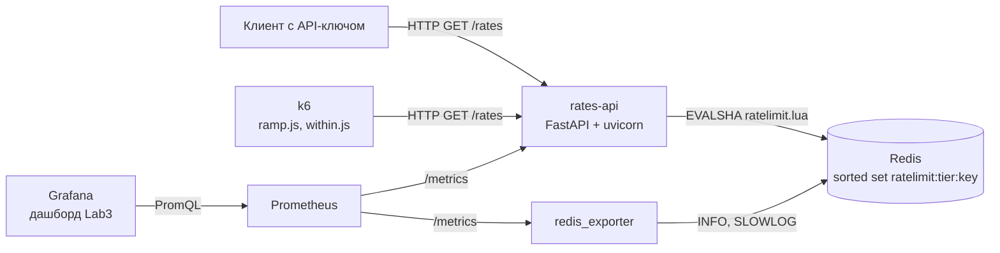
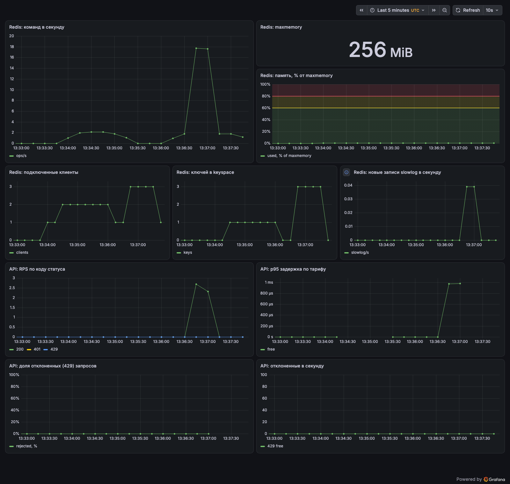
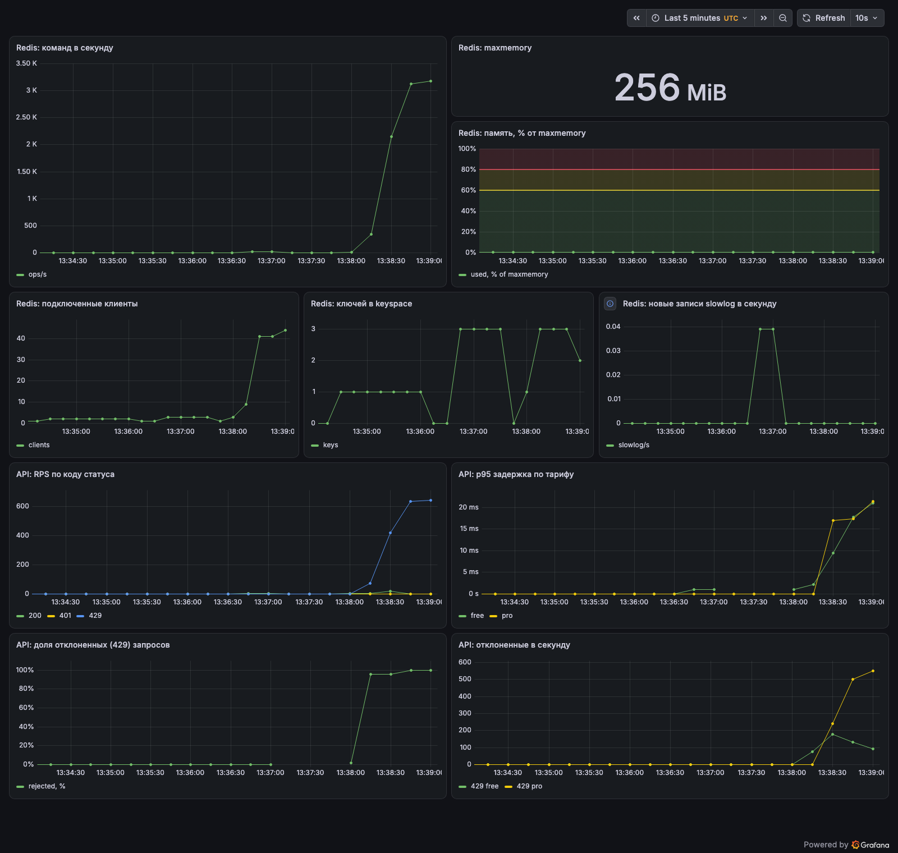
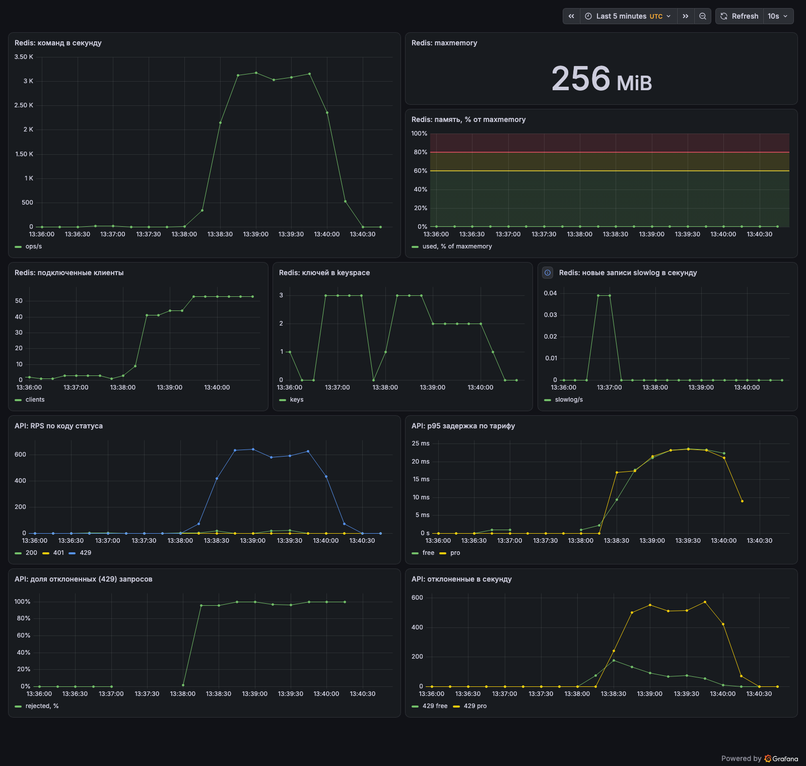

# Лабораторная работа 3. Эксплуатация Redis: rate limiter для API курсов валют

## Задача и требования

Я выбрал сценарий 4 - ограничение частоты запросов (rate limiter). Сервис - небольшое публичное HTTP API с курсами валют. Клиент приходит с API-ключом, а тариф ключа задает, сколько запросов в минуту ему можно

Требования к системе:

- функциональные: два тарифа, `free` на 60 запросов в минуту и `pro` на 600. Сверх лимита API отвечает `429 Too Many Requests` с заголовком `Retry-After`. Запросы считаются по API-ключу, а не по IP. Тариф ключа знает только сервер, так что клиент не получит `pro`, дописав к запросу `?tier=pro`
- нефункциональные: лимитер добавляет к запросу не больше нескольких миллисекунд, а p95 всего запроса укладывается в 250 мс. Если Redis недоступен, API не обслуживает трафик без лимита (fail-closed). Redis хранит только небольшие sorted set с TTL. Их не жалко потерять при рестарте: окна просто начнутся заново

## Почему скользящее окно

Я сравнил три подхода:

- фиксированное окно: просто, но на стыке двух минут клиент успевает сделать вдвое больше лимита, 60 запросов в конце одной минуты и 60 в начале следующей
- token bucket: сглаживает пики, но токены надо где-то доливать, фоном или расчетом в Lua, и честный `Retry-After` из него получить сложнее
- скользящее окно на sorted set: каждый запрос кладет в ZSET свою метку времени, устаревшие метки удаляются, а счетчиком служит `ZCARD`. Лимит ровный, без всплесков на границах минут, а `Retry-After` точно считается по самой старой метке в окне

Я выбрал скользящее окно: для API-лимита честная граница важнее простоты фиксированного окна

## Архитектурная схема



Все стоит на одной VM: Redis из официального apt-репозитория packages.redis.io (роль `redis`), приложение (роль `app`), k6 со сценариями нагрузки (роль `load`), Prometheus, redis_exporter и Grafana (роль `monitoring`). Все, кроме k6, работает как сервисы systemd. Версия Redis, число vCPU и память VM:

```bash
redis-server --version
```

```text
Redis server v=8.10.3 sha=00000000:1 malloc=jemalloc-5.3.0 bits=64 build=5ab44170ce1feca9
```

```bash
nproc
```

```text
2
```

```bash
free -h
```

```text
               total        used        free      shared  buff/cache   available
Mem:           3.8Gi       357Mi       117Mi       0.0Ki       3.4Gi       3.2Gi
Swap:             0B          0B          0B
```

## Развертывание

Ansible я запускаю со своего Mac из папки `lab3-redis/ansible`. Адрес VM inventory берет из переменной окружения `LAB3_REDIS_HOST`, так что в репозитории адресов нет. Пароль Redis лежит в `group_vars/lab3/vault.yml`. Этот файл в `.gitignore`, а в репозитории есть образец `vault.example.yml`. Путь к паролю от vault задает `ANSIBLE_VAULT_PASSWORD_FILE`. Все времена в отчете указаны в UTC

```bash
export LAB3_REDIS_HOST=<адрес VM>
export ANSIBLE_VAULT_PASSWORD_FILE=<путь к файлу с паролем vault>
cd lab3-redis/ansible
```

Первый прогон на чистой VM:

```bash
ansible-playbook site.yml
```

```text
...
PLAY RECAP *********************************************************************
redis-vm                   : ok=45   changed=36   unreachable=0    failed=0    skipped=0    rescued=0    ignored=0   
```

Первая попытка этого прогона упала на зависимостях приложения: `ERROR: Could not find a version that satisfies the requirement fastapi==0.163.*`, а последней доступной версией pip назвал 0.162.5. fastapi 0.163 требует Python 3.11, в Ubuntu 22.04 стоит 3.10, и pip молча пропускает несовместимые версии. Я закрепил `fastapi==0.162.*`, остальные пакеты из `requirements.txt` на Python 3.10 ставятся

Второй прогон ничего не меняет, changed=0:

```bash
ansible-playbook site.yml
```

```text
...
PLAY RECAP *********************************************************************
redis-vm                   : ok=38   changed=0    unreachable=0    failed=0    skipped=2    rescued=0    ignored=0   
```

Линтер из той же папки проходит с профилем production:

```bash
ansible-lint
```

```text
...
Passed: 0 failure(s), 0 warning(s) in 32 files processed of 40 encountered. Last profile that met the validation criteria was 'production'.
```

Все сервисы включены в автозагрузку и запущены. Строки вывода идут в том же порядке, что и юниты в команде:

```bash
systemctl is-enabled redis-server rates-api prometheus redis-exporter grafana-server
```

```text
enabled
enabled
enabled
enabled
enabled
```

```bash
systemctl is-active redis-server rates-api prometheus redis-exporter grafana-server
```

```text
active
active
active
active
active
```

Автозагрузку я проверил еще и перезагрузкой VM, после нее все пять сервисов поднялись сами:

```bash
reboot
```

```bash
uptime -p
```

```text
up 0 minutes
```

```bash
systemctl is-active redis-server rates-api prometheus redis-exporter grafana-server
```

```text
active
active
active
active
active
```

## Redis: установка и настройка

Redis ставится из официального apt-репозитория (роль `redis`). Конфиг собирается из шаблона `roles/redis/templates/redis.conf.j2`:

- `bind 127.0.0.1` - приложение живет на той же VM, снаружи Redis не нужен
- `requirepass` - пароль из Ansible Vault
- `maxmemory 256mb` - небольшим sorted set этого хватает с большим запасом
- `maxmemory-policy noeviction` - данные лимитера не кэш. Если Redis вытеснит чей-то ключ, лимитер забудет часть запросов и пропустит клиента сверх лимита. Памяти хватает с избытком, поэтому вытеснение выключено
- персистентность выключена (`save ""`, `appendonly no`): окна лимитов живут минуту, после рестарта они просто начинаются заново

Первый рестарт Redis после применения шаблона завис в `activating (start)`, и systemd ответил `Job for redis-server.service failed because a timeout was exceeded`, хотя Redis на PING уже отвечал. У юнита из пакета `Type=notify`, то есть systemd ждет от процесса сигнал sd_notify, а в моем шаблоне стояло `supervised no`. Помогло `supervised systemd` в redis.conf

Без пароля Redis отвечает NOAUTH:

```bash
redis-cli ping
```

```text
NOAUTH Authentication required.
```

Пароль из vault я кладу в переменную `REDISCLI_AUTH`, redis-cli берет его оттуда. Все следующие команды redis-cli идут уже с паролем:

```bash
export REDISCLI_AUTH=<пароль>
```

```bash
redis-cli ping
```

```text
PONG
```

Лимит памяти и политика вытеснения на работающем Redis:

```bash
redis-cli config get maxmemory maxmemory-policy
```

```text
maxmemory-policy
noeviction
maxmemory
268435456
```

## Приложение

Приложение - FastAPI под uvicorn (роль `app`, юнит `rates-api.service`, код в `roles/app/files/`):

- `GET /rates` отдает курсы валют. Клиент передает ключ в заголовке `X-API-KEY`. Тариф ключа сервер берет из своей таблицы `APP_KEY_TIERS` в юните, а неизвестный ключ считается `free`
- лимитер - Lua-скрипт `roles/app/files/ratelimit.lua`: `ZREMRANGEBYSCORE` чистит окно, `ZCARD` считает запросы, `ZADD` добавляет метку, `EXPIRE` ставит TTL. Redis выполняет скрипт целиком, поэтому параллельные запросы одного ключа не мешают друг другу
- успешный ответ несет `X-RateLimit-Remaining`, а отказ - `429` с `Retry-After` по самой старой метке в окне
- метрики для Prometheus: `api_requests_total{status, tier}` считает ответы по коду и тарифу, `api_request_latency_seconds` - время работы обработчика, `api_limiter_latency_seconds` - время одного вызова лимитера. Ожидание свободного воркера в `api_request_latency_seconds` не попадает, поэтому под нагрузкой ее p95 на дашборде намного меньше p95 из k6

В первой версии сумма `api_requests_total` в `/metrics` была 29 587, а k6 насчитал 57 723 запроса, то есть счетчики видели только половину трафика. uvicorn запускает два воркера, и у каждого процесса свои счетчики. Помог режим multiprocess из `prometheus_client`: юнит задает `PROMETHEUS_MULTIPROC_DIR` (каталог создает сам systemd через `RuntimeDirectory`), воркеры пишут счетчики туда, а `/metrics` собирает их через `MultiProcessCollector`. После этого сумма счетчиков совпала с числом запросов k6

Еще одна ошибка нашлась в k6: проверка `Retry-After` провалилась на всех 55 603 ответах 429 и прошла только на 1 320 ответах 200, которым заголовок не нужен. Я ставил заголовок в `response.headers` перед raise, но `HTTPException` собирает свой Response, и эти заголовки теряются. Теперь заголовки передаются прямо в `HTTPException(headers=...)`, и проверка проходит на всех ответах 429

Дальше проверки на VM: `/health`, заголовки лимита и запрос без ключа:

```bash
curl -s 127.0.0.1:8080/health
```

```text
{"status":"ok"}
```

```bash
curl -si 127.0.0.1:8080/rates -H 'X-API-KEY: demo'
```

```text
HTTP/1.1 200 OK
date: Fri, 20 Nov 2026 13:26:37 GMT
server: uvicorn
content-length: 59
content-type: application/json
x-ratelimit-remaining: 59

{"rates":{"USD/RUB":81.93,"EUR/RUB":89.86,"CNY/RUB":12.25}}
```

```bash
curl -si 127.0.0.1:8080/rates | head -1
```

```text
HTTP/1.1 401 Unauthorized
```

61-й запрос free-ключа за минуту получает 429:

```bash
for i in $(seq 61); do curl -s -o /dev/null -w '%{http_code} ' 127.0.0.1:8080/rates -H 'X-API-KEY: limitprobe'; done
```

```text
200 200 200 200 200 200 200 200 200 200 200 200 200 200 200 200 200 200 200 200 200 200 200 200 200 200 200 200 200 200 200 200 200 200 200 200 200 200 200 200 200 200 200 200 200 200 200 200 200 200 200 200 200 200 200 200 200 200 200 200 429 
```

Следующий запрос того же ключа получает 429 с `Retry-After`:

```bash
curl -si 127.0.0.1:8080/rates -H 'X-API-KEY: limitprobe' | grep -iE '^HTTP|retry-after'
```

```text
HTTP/1.1 429 Too Many Requests
retry-after: 59
```

Лимит считается по ключу, а не по IP: другой ключ `otherkey` в ту же секунду получает 200:

```bash
curl -si 127.0.0.1:8080/rates -H 'X-API-KEY: otherkey' | head -1
```

```text
HTTP/1.1 200 OK
```

Тариф решает сервер, поэтому тот же free-ключ с `?tier=pro` все равно получает 429:

```bash
curl -si '127.0.0.1:8080/rates?tier=pro' -H 'X-API-KEY: limitprobe' | head -1
```

```text
HTTP/1.1 429 Too Many Requests
```

Через минуту, как и обещал `Retry-After`, ключ снова проходит. Запрос с 429 ушел в 13:36:32, этот - в 13:37:33:

```bash
curl -si 127.0.0.1:8080/rates -H 'X-API-KEY: limitprobe' | head -1
```

```text
HTTP/1.1 200 OK
```

## Поведение при отказе Redis

По требованию API не обслуживает трафик, пока Redis недоступен. В юните приложения стоит `Requires=redis-server.service`, так что при остановке Redis systemd останавливает и приложение, и клиент получает отказ в соединении, а не запрос без лимита. Если Redis пропадет прямо во время запроса, код ответит `503`

Сначала я ждал от этой проверки HTTP 503, но curl не получил ответа вовсе, только `Connection refused`. Приложение к этому моменту уже остановлено вместе с Redis из-за того же `Requires`. Для fail-closed это правильное поведение: без лимитера трафик не обслуживается

Кроме `Requires`, в юните стоит `WantedBy=redis-server.service`: когда Redis возвращается, systemd сам запускает и приложение:

```bash
systemctl stop redis-server
```

```bash
systemctl is-active rates-api
```

```text
inactive
```

```bash
curl -sS 127.0.0.1:8080/rates -H 'X-API-KEY: neg'
```

```text
curl: (7) Failed to connect to 127.0.0.1 port 8080 after 0 ms: Connection refused
```

```bash
systemctl start redis-server
```

```bash
systemctl is-active rates-api
```

```text
active
```

```bash
curl -s 127.0.0.1:8080/health
```

```text
{"status":"ok"}
```

## Нагрузочное тестирование

Нагрузку дает k6 (роль `load`, сценарий `roles/load/files/ramp.js`), запускаю его на самой VM. В сценарии два потока: free-ключ наращивает нагрузку до 40 VU, pro-ключ с 10-й секунды наращивает до 300 VU, всего 110 секунд. На пике это около 38 500 запросов в минуту (642 запроса в секунду по Prometheus ниже), почти в 60 раз больше суммарного лимита в 660 запросов в минуту. Квоты я превышаю специально, чтобы увидеть отказы. Порог сценария - p95 меньше 250 мс. Ответ 429 отмечен ожидаемым статусом (`http.expectedStatuses(200, 429)`), иначе k6 считал бы каждый отказ лимитера ошибкой

Перед прогоном я очищаю базу и сбрасываю статистику Redis, чтобы `commandstats` ниже охватил только прогрев и рампу:

```bash
redis-cli flushdb
```

```text
OK
```

```bash
redis-cli config resetstat
```

```text
OK
```

Сколько стоит сам лимитер, показывает гистограмма `api_limiter_latency_seconds`. Снимаю ее после 61 прогревочного запроса без нагрузки. Счетчики начались с нуля, потому что приложение перезапустилось вместе с Redis в проверке выше:

```bash
for i in $(seq 61); do curl -s -o /dev/null 127.0.0.1:8080/rates -H 'X-API-KEY: warmup'; done
```

```bash
curl -s 127.0.0.1:8080/metrics | grep ^api_limiter_latency_seconds
```

```text
api_limiter_latency_seconds_sum 0.04016243400005237
api_limiter_latency_seconds_bucket{le="0.0001"} 0.0
api_limiter_latency_seconds_bucket{le="0.00025"} 0.0
api_limiter_latency_seconds_bucket{le="0.0005"} 27.0
api_limiter_latency_seconds_bucket{le="0.001"} 59.0
api_limiter_latency_seconds_bucket{le="0.0025"} 59.0
api_limiter_latency_seconds_bucket{le="0.005"} 60.0
api_limiter_latency_seconds_bucket{le="0.01"} 61.0
api_limiter_latency_seconds_bucket{le="0.025"} 61.0
api_limiter_latency_seconds_bucket{le="0.05"} 61.0
api_limiter_latency_seconds_bucket{le="+Inf"} 61.0
api_limiter_latency_seconds_count 61.0
```

Все 61 вызов уложились в 10 мс, 59 из них - в миллисекунду

Redis до рампы:

```bash
redis-cli info | grep -E '^(connected_clients|used_memory_human|used_memory_peak_human|total_commands_processed|instantaneous_ops_per_sec):'
```

```text
connected_clients:3
used_memory_human:1.02M
used_memory_peak_human:1.02M
total_commands_processed:375
instantaneous_ops_per_sec:231
```

Рампу запускаю во втором терминале, ниже конец ее вывода:

```bash
k6 run /opt/rates-load-test/ramp.js
```

```text
...
  █ THRESHOLDS 

    checks
    ✓ 'rate>0.5' rate=100.00%

    http_req_duration
    ✗ 'p(95)<250' p(95)=716.11ms


  █ TOTAL RESULTS 

    checks_total.......: 126082  1145.840918/s
    checks_succeeded...: 100.00% 126082 out of 126082
    checks_failed......: 0.00%   0 out of 126082

    ✓ 200 or 429
    ✓ Retry-After on 429

    HTTP
    http_req_duration..............: avg=408.36ms min=2.35ms med=437.66ms max=1.36s p(90)=646.59ms p(95)=716.11ms
      { expected_response:true }...: avg=408.36ms min=2.35ms med=437.66ms max=1.36s p(90)=646.59ms p(95)=716.11ms
    http_req_failed................: 0.00%  0 out of 63041
    http_reqs......................: 63041  572.920459/s
...
time="2026-11-19T13:39:50Z" level=error msg="thresholds on metrics 'http_req_duration' have been crossed"
```

Порог p95 в перегрузочном прогоне провален, как и ожидалось: p95 запроса - 716 мс. Но лимитер ни разу не сломался: `http_req_failed` 0%, и все проверки прошли, включая `Retry-After` на каждом 429

На 60-й секунде рампы, когда pro-поток уже держит 300 VU, в первом терминале:

```bash
vmstat 1 2
```

```text
procs -----------memory---------- ---swap-- -----io---- -system-- ------cpu-----
 r  b   swpd   free   buff  cache   si   so    bi    bo   in   cs us sy id wa st
 7  1      0 2033720  25000 1248972    0    0  2748  1875 1987 4661 26 10 46 18  0
 3  1      0 2033720  25000 1249668    0    0     0  1764 9429 27038 72 21  4  3  0
```

```bash
redis-cli info | grep -E '^(connected_clients|used_memory_human|used_memory_peak_human|total_commands_processed|instantaneous_ops_per_sec):'
```

```text
connected_clients:44
used_memory_human:1.38M
used_memory_peak_human:1.56M
total_commands_processed:166934
instantaneous_ops_per_sec:2763
```

Оба vCPU заняты: во второй строке `vmstat`, то есть за последнюю секунду, us 72 и sy 21, простой всего 4%. Redis в этот момент выполняет 2 763 команды в секунду, к нему подключены 44 клиента, а память почти не выросла, 1.38M против 1.02M до рампы

Сразу после конца рампы:

```bash
redis-cli info | grep -E '^(connected_clients|used_memory_human|used_memory_peak_human|total_commands_processed|instantaneous_ops_per_sec):'
```

```text
connected_clients:53
used_memory_human:1.39M
used_memory_peak_human:1.57M
total_commands_processed:317279
instantaneous_ops_per_sec:141
```

Сколько времени Redis сам тратит на один вызов лимитера за прогрев и рампу, видно по `usec_per_call` в `commandstats`:

```bash
redis-cli info commandstats | grep evalsha
```

```text
cmdstat_evalsha:calls=63103,usec=2112397,usec_per_call=33.48,rejected_calls=0,failed_calls=1
```

Это 33 микросекунды на вызов. Вызовов на один больше, чем запросов прошло через лимитер (63 103 против 63 102 ниже), и есть ровно один `failed_calls`. Это первый EVALSHA после рестарта Redis: он получил NOSCRIPT, redis-py загрузил скрипт и повторил вызов

Счетчики приложения после рампы:

```bash
curl -s 127.0.0.1:8080/metrics | grep -E '^api_(requests_total|limiter_latency_seconds_(bucket|count))'
```

```text
api_requests_total{status="200",tier="free"} 180.0
api_requests_total{status="429",tier="free"} 10461.0
api_requests_total{status="200",tier="pro"} 1200.0
api_requests_total{status="429",tier="pro"} 51261.0
api_limiter_latency_seconds_bucket{le="0.0001"} 0.0
api_limiter_latency_seconds_bucket{le="0.00025"} 0.0
api_limiter_latency_seconds_bucket{le="0.0005"} 2591.0
api_limiter_latency_seconds_bucket{le="0.001"} 8428.0
api_limiter_latency_seconds_bucket{le="0.0025"} 20685.0
api_limiter_latency_seconds_bucket{le="0.005"} 35867.0
api_limiter_latency_seconds_bucket{le="0.01"} 52044.0
api_limiter_latency_seconds_bucket{le="0.025"} 62198.0
api_limiter_latency_seconds_bucket{le="0.05"} 62885.0
api_limiter_latency_seconds_bucket{le="+Inf"} 63102.0
api_limiter_latency_seconds_count 63102.0
```

Сумма `api_requests_total` - 63 102, то есть 63 041 запрос k6 и 61 прогревочный, счетчики видят оба воркера uvicorn. По числам виден и сам лимит: pro-ключ за 100 секунд рампы получил ровно 1 200 ответов 200, по 600 на каждое минутное окно, а free-ключи - 180, из них 60 у прогревочного ключа и 120 у ключа рампы. Зато в 10 мс уложились только 52 044 вызова лимитера из 63 102, хотя без нагрузки почти все укладывались в миллисекунду. Сам Redis тратит на вызов 33 микросекунды, значит, время уходит на ожидание CPU в двух воркерах uvicorn, а не в Redis

Пик RPS по сумме счетчиков и пик p95 лимитера за последние 15 минут, из Prometheus:

```bash
curl -sG 127.0.0.1:9090/api/v1/query --data-urlencode 'query=max_over_time(sum(rate(api_requests_total[30s]))[15m:30s])'
```

```text
{"status":"success","data":{"resultType":"vector","result":[{"metric":{},"value":[1795095593.323,"642.16"]}]}}
```

```bash
curl -sG 127.0.0.1:9090/api/v1/query --data-urlencode 'query=max_over_time(histogram_quantile(0.95, sum by (le) (rate(api_limiter_latency_seconds_bucket[30s])))[15m:30s])'
```

```text
{"status":"success","data":{"resultType":"vector","result":[{"metric":{},"value":[1795095594.122,"0.023438775510204075"]}]}}
```

Пик - 642 запроса в секунду, p95 лимитера в худший момент - 23 мс

Отдельный сценарий `within.js` проверяет p95 при нагрузке в пределах тарифов: free 55 запросов в минуту, pro 540, executor constant-arrival-rate, 2 минуты. Здесь каждый ответ обязан быть 200 (`checks: rate==1`), один 429 провалит прогон. Перед ним я перезапускаю приложение, чтобы счетчики охватили только этот прогон:

```bash
systemctl restart rates-api
```

```bash
k6 run /opt/rates-load-test/within.js
```

```text
...
  █ THRESHOLDS 

    checks
    ✓ 'rate==1' rate=100.00%

    http_req_duration
    ✓ 'p(95)<250' p(95)=4.71ms


  █ TOTAL RESULTS 

    checks_total.......: 1191    9.924391/s
    checks_succeeded...: 100.00% 1191 out of 1191
    checks_failed......: 0.00%   0 out of 1191

    ✓ 200

    HTTP
    http_req_duration..............: avg=3.96ms min=2.26ms med=3.83ms max=39.92ms p(90)=4.35ms p(95)=4.71ms
      { expected_response:true }...: avg=3.96ms min=2.26ms med=3.83ms max=39.92ms p(90)=4.35ms p(95)=4.71ms
    http_req_failed................: 0.00%  0 out of 1191
    http_reqs......................: 1191   9.924391/s
...
free_tier ✓ [ 100% ] 00/05 VUs  2m0s  0.92 iters/s
pro_tier  ✓ [ 100% ] 00/20 VUs  2m0s  9.00 iters/s
```

Все 1 191 запрос получили 200, p95 - 4.71 мс при бюджете 250 мс. В счетчиках приложения 111 + 1 080 ответов 200 и ни одного 429, почти все вызовы лимитера уложились в миллисекунду:

```bash
curl -s 127.0.0.1:8080/metrics | grep -E '^api_(requests_total|limiter_latency_seconds_(bucket|count))'
```

```text
api_requests_total{status="200",tier="free"} 111.0
api_requests_total{status="200",tier="pro"} 1080.0
api_limiter_latency_seconds_bucket{le="0.0001"} 0.0
api_limiter_latency_seconds_bucket{le="0.00025"} 0.0
api_limiter_latency_seconds_bucket{le="0.0005"} 24.0
api_limiter_latency_seconds_bucket{le="0.001"} 1167.0
api_limiter_latency_seconds_bucket{le="0.0025"} 1188.0
api_limiter_latency_seconds_bucket{le="0.005"} 1191.0
api_limiter_latency_seconds_bucket{le="0.01"} 1191.0
api_limiter_latency_seconds_bucket{le="0.025"} 1191.0
api_limiter_latency_seconds_bucket{le="0.05"} 1191.0
api_limiter_latency_seconds_bucket{le="+Inf"} 1191.0
api_limiter_latency_seconds_count 1191.0
```

## Мониторинг

Роль `monitoring` ставит Prometheus, redis_exporter и Grafana как сервисы systemd. Datasource и дашборд Grafana подхватывает из файлов при старте (`grafana-datasource.yml`, `grafana-dashboard-provider.yml`, `rates-dashboard.json`), руками в интерфейсе ничего не настраивается. Prometheus опрашивает только два источника, из них и строится дашборд:

```bash
curl -s 127.0.0.1:9090/api/v1/targets | grep -oE '"(scrapePool|health)":"[^"]*"'
```

```text
"scrapePool":"rates-api"
"health":"up"
"scrapePool":"redis_exporter"
"health":"up"
```

С Grafana вышла неожиданность: добавление ключа репозитория падало с `Could not fetch signed_by key: HTTP Error 403: Access Denied`, а dl.grafana.com отвечал 451. Похоже, CDN Grafana не отдает файлы на российские IP, но проверить это мне нечем. GitHub с VM открывается, поэтому Grafana ставится deb-пакетом из GitHub releases (`get_url`, затем `apt` с `deb:`), без репозитория. Тут же всплыла и моя ошибка: по привычке к Mac на Apple Silicon я указал в ролях arm64-сборки. Архивы с ними распаковались без единой жалобы, и только dpkg отказался ставить пакет Grafana с `Wrong architecture arm64`. Все ссылки я перевел на linux-amd64

Дашборд "Lab3: Redis rate limiter" (uid `lab3-redis`), панели:

- Redis: команд в секунду (`redis_commands_processed_total`)
- Redis: maxmemory - лимит памяти числом (`redis_memory_max_bytes`)
- Redis: память, % от maxmemory - график с цветными зонами: до 60% зеленая, 60-80% желтая, выше 80% красная
- Redis: подключенные клиенты (`redis_connected_clients`)
- Redis: ключей в keyspace (`redis_db_keys`) - один ключ на каждого активного клиента API
- Redis: новые записи slowlog в секунду (`rate(redis_slowlog_last_id[30s])`). Номер последней записи растет, даже когда сам slowlog уже заполнен, а обнуление номера при рестарте Redis `rate` воспринимает как сброс счетчика
- API: RPS по коду статуса (`api_requests_total`)
- API: p95 задержка по тарифу (histogram_quantile по `api_request_latency_seconds`)
- API: доля отклоненных запросов (процент 429 от всех)
- API: отклоненные в секунду по тарифу (`sum by (tier) (rate(api_requests_total{status="429"}[30s]))`)

Где метрики нет, панель показывает 0, а не "No data" (`noValue`). Дашборд я снял три раза, окно - последние 5 минут

До нагрузки, 13:37:47:



Во время рампы, на 62-й секунде, 13:39:01:



Через минуту после конца рампы, 13:40:50:



## Что было сложно, а что интересно

Сложнее всего было с окружением: Redis зависал на старте из-за `Type=notify`, CDN Grafana не отдавал пакеты, и пришлось переехать на GitHub releases, а свежий fastapi молча не ставился на Python из Ubuntu 22.04. Каждая история описана выше, там, где она случилась

Интересно было смотреть, как нагрузка сама показывает узкое место. Redis тратит на вызов лимитера 33 микросекунды, а гистограмма в приложении под перегрузкой растягивается до десятков миллисекунд, то есть время уходит на ожидание CPU, а не на Redis. При этом лимитер ни разу не ошибся: `Retry-After` считался по самой старой метке окна, и через минуту после отказа ключ снова проходил
